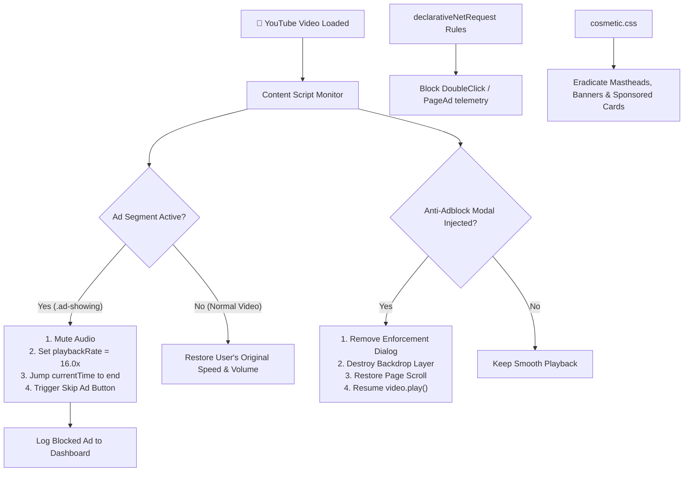

<div align="center">

  

  # AdShield for YouTube™
  ### *Watch everything. See nothing. Completely ad-free.*

  [](manifest.json)
  [](https://github.com)
  [](src/background.js)
  [](LICENSE)

  <p align="center">
    <b>A lightweight, undetectable open-source extension that beats YouTube’s adblocker crackdown.</b><br>
    Plays ads at 16x speed, auto-skips in ~0.15s, silences audio, and unfreezes anti-adblock modals.
  </p>

  <p align="center">
    <a href="#-the-problem--how-adshield-wins"><b>The Difference</b></a> •
    <a href="#-key-features"><b>Key Features</b></a> •
    <a href="#-30-second-quick-install"><b>Quick Install</b></a> •
    <a href="#-how-it-works"><b>How It Works</b></a> •
    <a href="#-faq"><b>FAQ</b></a>
  </p>

</div>

---

> ### ⚡ The 5-Second Pitch
> **That 30s unskippable YouTube ad? Gone in 0.15s.**  
> AdShield beats YouTube’s adblocker crackdown by running ads at 16x speed with instant auto-skip and smart mute. Zero warning popups. Zero screen freeze. Completely free, undetectable & 100% open-source forever. 🛡️

---

## 🥊 The Problem & How AdShield Wins

YouTube regularly flags conventional ad blockers by tracking interrupted streaming sockets and missing telemetry beacons, hitting viewers with the dreaded message:

```
┌────────────────────────────────────────────────────────────────────────┐
│  ⚠️  Ad blockers violate YouTube's Terms of Service                    │
│      It looks like you may be using an ad blocker. Video playback      │
│      will be blocked unless you allow ads or subscribe to Premium...   │
└────────────────────────────────────────────────────────────────────────┘
```

When standard blockers get detected, videos pause, your screen gets locked with a grey backdrop, and playback is throttled.

### 🛡️ Why AdShield Cannot Be Detected

Instead of violently dropping network connections (which trips YouTube's detection traps), **AdShield plays by YouTube's rules at hyperspeed**:

| Feature / Behavior | Traditional Ad Blockers | 🛡️ AdShield Engine |
|---|:---:|:---:|
| **Instream Video Ads** | Blocks network stream *(Causes detection & errors)* | **16.0x Speedup + Instant Auto-Skip in ~0.15s** |
| **Ad Audio Bleed** | Audible screeching or loud ads | **Instant Smart-Mute (0 audio bleed)** |
| **Anti-Adblock Modals** | Video permanently frozen & blocked | **Auto-intercepted, destroyed & unpaused** |
| **Site Appearance** | Broken layouts & blank grey boxes | **Zero-flicker CSS banner & sponsor purge** |
| **Resource Usage** | Heavy rulesets eating memory | **Sub-5MB RAM, Manifest V3 Native** |
| **Privacy & Telemetry** | Often tracks user habits | **100% Local (0 servers, 0 telemetry)** |

---

## ✨ Key Features

- ⚡ **16x Hyper-Skip Engine**: Detects preroll, midroll, and postroll ads and fast-forwards through them in the blink of an eye.
- 🔇 **Zero-Noise Smart Mute**: Audio is silenced during ad fast-forwarding and instantly restored to your exact volume the moment your video resumes.
- 🚫 **Anti-Adblock Enforcement Defeater**: Automatically strips `ytd-enforcement-message-view-model` dialogs, clears backdrops, and un-pauses videos.
- 🧹 **Zero-Flicker Layout Cleanser**: Hides homepage hero mastheads, sponsored search listings, sidebar companion ads, and merch cards with pure GPU-accelerated CSS.
- 📊 **Real-Time Savings Dashboard**: Sleek cyber-glass popup showing your total ads neutralized and minutes/hours of your life reclaimed.
- 🔋 **Ultralight Battery Footprint**: Powered by modern Chrome Manifest V3 declarative rules and lean DOM mutation observers.
- 🔒 **No Telemetry, Zero Tracking**: No accounts, no subscriptions, no external analytics. All data stays strictly in your browser.

---

## 🚀 30-Second Quick Install

No coding skills or terminal required! Works on **Google Chrome**, **Brave**, **Microsoft Edge**, **Opera**, and **Vivaldi**.

```
  1. Download ZIP    ➜    2. Open Extensions    ➜    3. Toggle Dev Mode    ➜    4. Load Unpacked
```

### Step 1: Download AdShield
Grab the ready-to-run package:
- Click **[Releases](https://github.com/your-username/youtube-ad-shield/releases)** on the right sidebar and download **`adshield-youtube-v1.0.0.zip`**.
- Unzip (Extract) the downloaded folder on your computer.

### Step 2: Open Extension Settings
Paste the URL for your browser into your address bar and hit **Enter**:
- **Chrome / Brave / Vivaldi**: `chrome://extensions`
- **Microsoft Edge**: `edge://extensions`
- **Opera**: `opera://extensions`

### Step 3: Turn on Developer Mode
Flip the **Developer mode** toggle switch in the **top-right corner** to **ON**.

### Step 4: Click "Load unpacked"
1. Click the **Load unpacked** button in the top-left menu.
2. Select the unzipped `youtube-ad-shield` folder (the one containing `manifest.json`).
3. Click the **puzzle icon (🧩)** on your browser toolbar and **pin 📌 AdShield**.
4. Head over to [YouTube.com](https://www.youtube.com) and enjoy uninterrupted video!

---

## 🧠 How It Works

AdShield combines a high-speed JavaScript actuation loop with declarative network shielding and cosmetic DOM filters:



---

## 🎛️ Extension Dashboard

Click the **AdShield shield icon** in your browser toolbar anytime to open the Glassmorphic control panel:

```text
┌──────────────────────────────────────────────┐
│  🛡️  AdShield              [ PROTECTED ]     │
│      YouTube™ Ad Blocker                     │
├──────────────────────────────────────────────┤
│  Master Protection                  [  ON  ] │
│  Active and blocking ads                     │
├──────────────────────┬───────────────────────┤
│         128          │         42m           │
│   Ads Neutralized    │     Time Saved        │
├──────────────────────┴───────────────────────┤
│  ⚡ Fast-Forward & Auto-Skip         [  ON  ] │
│  🔇 Smart Mute                       [  ON  ] │
│  🧹 Banners & Merch Blocker          [  ON  ] │
│  🚫 Anti-Adblocker Defeater          [  ON  ] │
├──────────────────────────────────────────────┤
│  [ Reset Stats ]              ⭐ Open Source │
└──────────────────────────────────────────────┘
```

---

## 🧪 Interactive Developer Test Harness

Want to test AdShield's detection algorithms without waiting for random YouTube ads?

1. Open [`tests/test_selectors.html`](tests/test_selectors.html) directly in any web browser.
2. Click **"Trigger 15s Video Ad"** to simulate instream player ads.
3. Click **"Inject YouTube Anti-Adblock Modal"** to simulate enforcement dialogs.
4. Run automated selector tests to verify cross-browser compatibility.

---

## 💬 FAQ

<details>
<summary><b>Will my YouTube account get banned or flagged?</b></summary>
<p>
No. AdShield does not modify user account tokens, scrape data, or violate YouTube streaming protocols. It runs ads forward at high speed and automatically clicks the visible "Skip" button just like a human viewer with lightning-fast reflexes.
</p>
</details>

<details>
<summary><b>Does AdShield collect or sell my browsing data?</b></summary>
<p>
Never. AdShield is 100% open-source and has zero telemetry servers, zero analytic trackers, and zero external dependencies. All stats (ads skipped, time saved) are stored strictly on your local machine via <code>chrome.storage.local</code>.
</p>
</details>

<details>
<summary><b>Does it work on YouTube Shorts and Livestreams?</b></summary>
<p>
Yes! Cosmetic filters automatically suppress sponsored Shorts video cards, merchandise shelves, and display ads across regular videos, Shorts feeds, and livestreams.
</p>
</details>

<details>
<summary><b>How can I temporarily disable it?</b></summary>
<p>
Click the AdShield icon in your browser toolbar and toggle the <b>Master Protection</b> switch off. Click it again to re-enable it instantly.
</p>
</details>

---

## 🤝 Contributing

Contributions make the open-source community an incredible place to learn, inspire, and create. Any contributions you make are **greatly appreciated**!

1. Fork the Project
2. Create your Feature Branch (`git checkout -b feature/AmazingFeature`)
3. Commit your Changes (`git commit -m 'feat: add support for new skip button selector'`)
4. Push to the Branch (`git push origin feature/AmazingFeature`)
5. Open a Pull Request

See [CONTRIBUTING.md](CONTRIBUTING.md) for full developer guidelines.

---

## ⚖️ License & Disclaimer

- Distributed under the **MIT License**. See [`LICENSE`](LICENSE) for more information.
- *Disclaimer: YouTube™ is a trademark of Google LLC. AdShield is an independent open-source project and is not affiliated with, sponsored by, or endorsed by Google LLC or YouTube.*

---

<div align="center">

**If AdShield saved your sanity on YouTube, please consider giving us a ⭐ star on GitHub!**

Made with ❤️ by the Open Source Community

</div>
